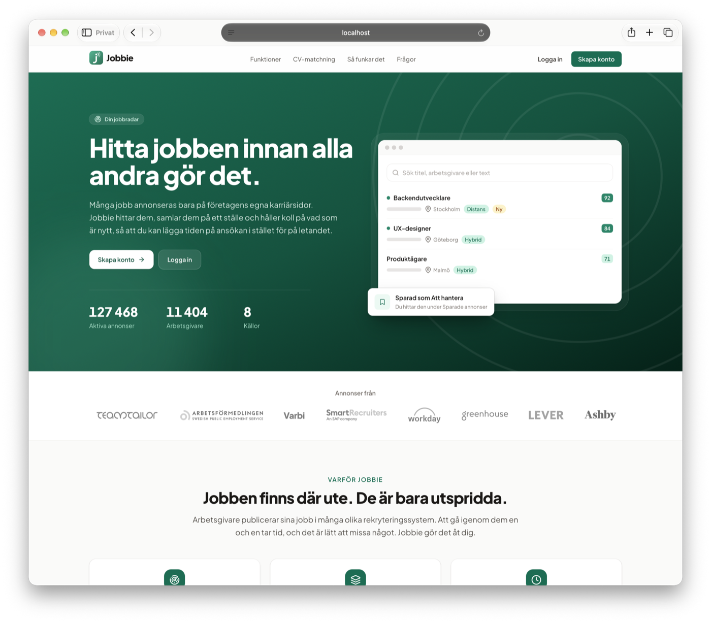
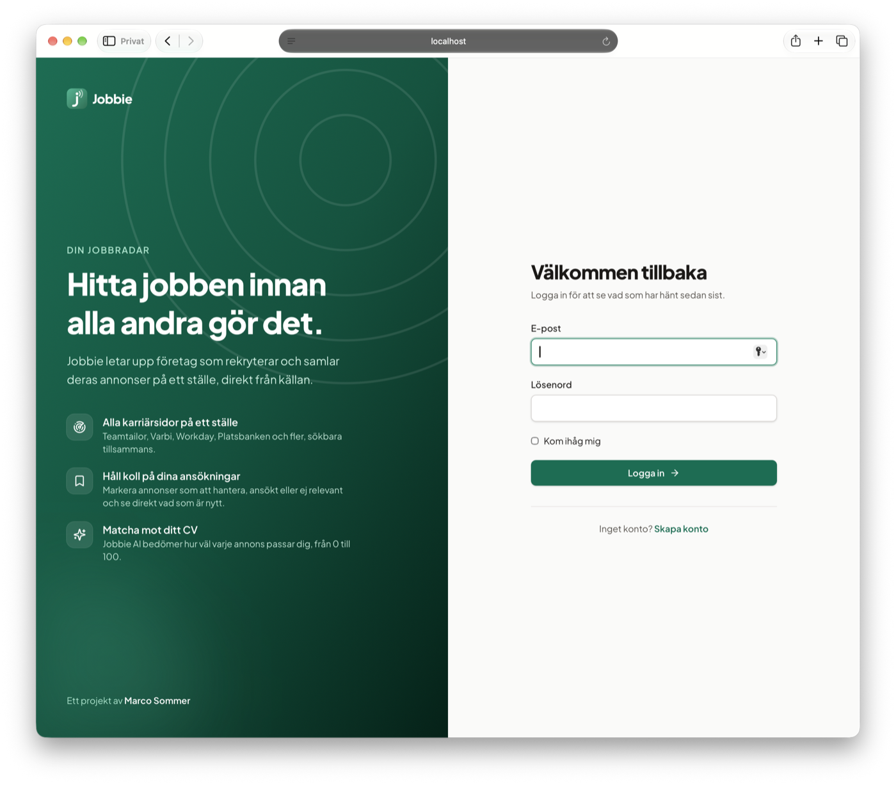
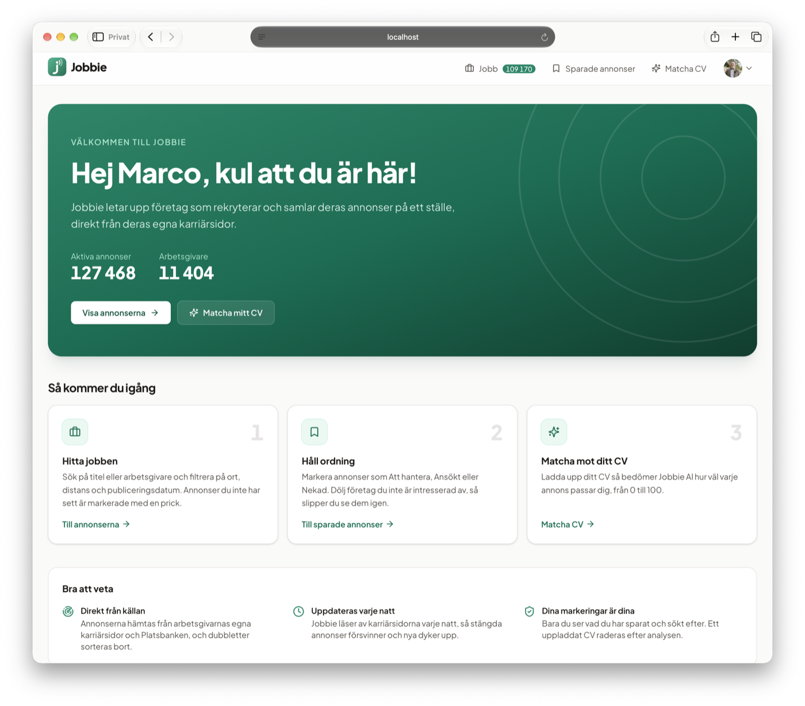
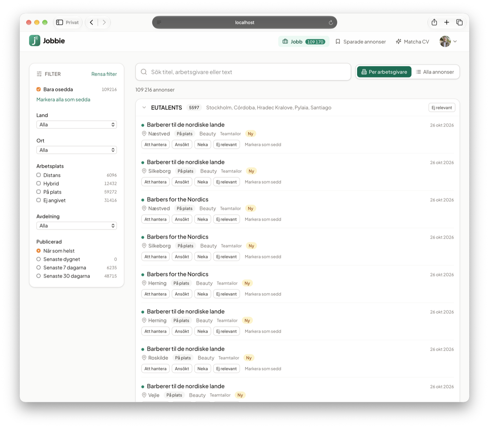
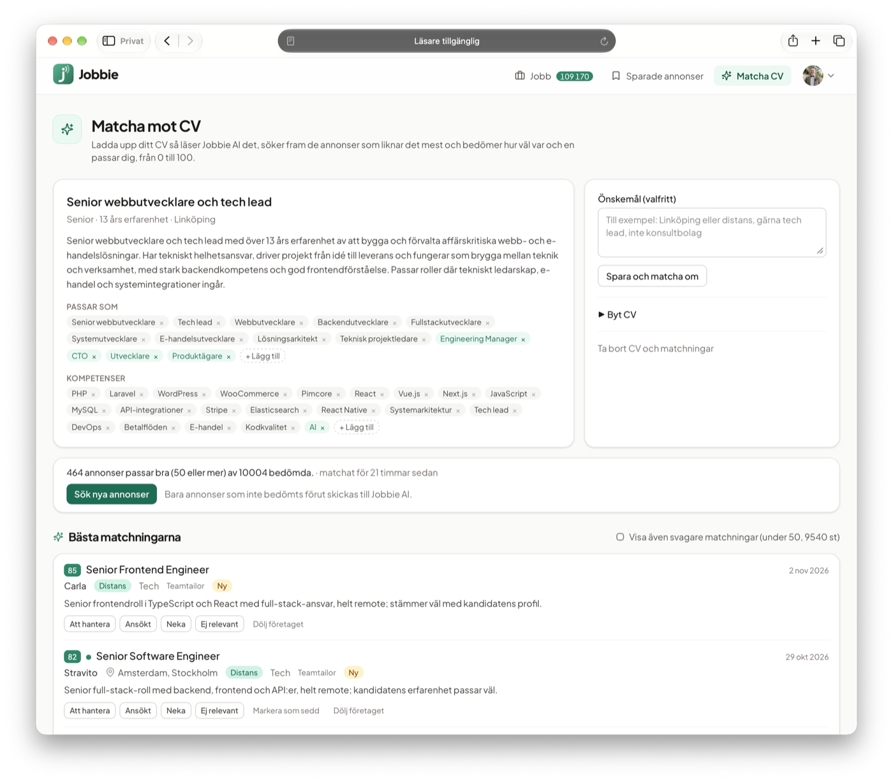

<p align="center">
  
</p>

<h1 align="center">Jobbie</h1>

<p align="center">
  <strong>Jobs, straight from the employers’ career sites.</strong><br>
  A Laravel app that finds Swedish companies that are hiring, collects their job postings and lets you search, track and match them against your CV.
</p>



Many jobs are only posted on a company’s own career site. Jobbie reads postings directly from the employers’ recruitment systems (Teamtailor, Varbi, SmartRecruiters, Workday, Greenhouse, Lever and Ashby) and from Platsbanken, removes duplicates and shows everything in one filterable list. For Teamtailor it also finds career sites on the employer’s own domain (for example `career.company.se`).

**Features**

* One list of every active posting, grouped by employer or flat, with free-text search and filters for country, city, remote work, department and publishing date.
* Unseen postings are marked and counted, so you see what is new since your last visit.
* Mark postings as *To do*, *Applied*, *Rejected* or *Not relevant*, and hide whole companies.
* Upload a CV and let Jobbie AI (Claude) score how well each posting fits you, from 0 to 100, with a reason.
* Postings are refreshed every night, and new employers are discovered every week.

The interface is in Swedish by default, with an English translation (`APP_LOCALE=sv` or `en`).

## Screenshots

| | |
| --- | --- |
|  |  |
| **Log in.** The brand panel explains the app; registration is one click away. | **Welcome.** New accounts land here, with live numbers and three steps to get started. |
|  |  |
| **Job list.** Filters with live counts, grouped by employer, unseen postings marked with a dot. | **CV matching.** An editable profile from the CV, and postings scored 0–100 with a reason. |

## Requirements

* PHP 8.4 with the `intl`, `pdo_mysql`, `pcntl` and `redis` extensions
* Composer 2 and Node.js (for the front-end build)
* MySQL 8 and Redis 7 (or Docker)

## Getting started

```sh
cp .env.example .env
docker compose up -d mysql redis
composer install
php artisan key:generate
php artisan migrate
npm install && npm run build
php artisan radar:user you@example.com --admin
```

`docker compose up -d` starts the whole environment (web server, Horizon, MySQL and Redis). `php artisan db:seed --class=DemoSeeder` fills the database with made-up postings to try things out with.

The schedule in `routes/console.php` runs with `php artisan schedule:work` (or cron calling `schedule:run`): scraping every night at 03:00, Platsbanken duplicate matching at 05:30, discovery and verification every Monday, the Public Suffix List every Sunday and Horizon snapshots every five minutes.

## Checks

| Command | What it does |
| --- | --- |
| `composer test` | Pest without MySQL (in-memory SQLite) |
| `composer test:mysql` | The tests in the `mysql` group; needs a MySQL database as configured in `DB_*` |
| `composer analyse` | Larastan, level 6 |
| `composer lint` | Pint in check mode (PSR-12 and `declare(strict_types=1)`) |
| `composer format` | Pint, fixing the files |

All tests run offline. `Http::preventStrayRequests()` is on, and DNS and TLS are replaced by fake clients in `tests/Fakes`.

## Commands

| Command | What it does |
| --- | --- |
| `radar:user {email}` | Creates an account, or sets a new password for an existing one. Asks for the password (at least 8 characters). `--name=` sets the display name and `--admin` grants admin rights |
| `radar:admin {email}` | Grants an existing account admin rights. `--revoke` takes them away |
| `radar:calibrate {hosts*}` | Records DNS, TLS and HTTP for known career sites (see Calibration) |
| `radar:import-legacy {path}` | Reads the Python prototype’s SQLite file and creates strong candidates with the source `seed` |
| `radar:update-psl` | Downloads the Public Suffix List to `storage/app/psl/` |
| `radar:discover` | Collects candidates from the sources in `RADAR_SOURCES` or `--source=` (`jobstream`, `prefixes`, `commoncrawl`, `wayback`). `--domains=file.csv` adds base domains for prefix probing, `--sync` runs everything in-process instead of on the queue |
| `radar:verify` | Queues verification of new candidates, in batches of 200, strong ones first. Rejected candidates and fingerprint matches without a feed are retried after `RADAR_REJECTED_RECHECK_DAYS` days. `--source=` and `--limit=` narrow the selection |
| `radar:smoke {hosts?*}` | Manual smoke test against real career sites (three known ones by default). Verifies and reads the feed and RSS without writing to the database. Not part of CI |
| `radar:match-platsbanken` | Hides Platsbanken’s copies of postings that are also read from the employer’s own system (runs every night) |
| `radar:stats` | Candidates per source and stage, active career sites and postings per source, breakdown by type and status, verified sites per prefix and TXT customers without a found site |
| `radar:match {email} {cv?}` | Matches a CV (PDF) against the postings with Claude, without the queue, and lists the best matches. Without a file, the account’s current profile is matched against new postings. `--preferences=` sets preferences and `--top=` the number of rows |
| `radar:scrape` | Queues a scrape of every career site as a batch and shows progress. `--only-active` takes only sites that had postings, `--host=` picks sites by canonical host or alias, `--platform=` picks platforms (`teamtailor`, `varbi`, `smartrecruiters`, `workday`, `greenhouse`, `lever`, `ashby`, `platsbanken`), `--no-wait` exits right after queueing. Platsbanken is read from JobStream rather than scraped: the run queues `SyncJobStream`, unless it is limited with `--host=` or to other platforms |

`radar:import-legacy` looks in every table for the first column named `host`, `hostname`, `canonical_host`, `board_host`, `domain`, `url`, `career_url`, `home_url`, `feed_url` or `base_url`, since the prototype’s schema is not in the repository. Values are normalised and hosts already known are skipped.

The registrable domain is worked out with the Public Suffix List. A copy is kept in `resources/psl/` and used until `radar:update-psl` has downloaded a fresh one.

## Web interface

| Path | Page |
| --- | --- |
| `/` | For guests, the landing page: what Jobbie does, live numbers, the sources, features, CV matching, how it works and an FAQ. For signed-in users, the job list |
| `/login`, `/register` | Log in and create an account |
| `/valkommen` | The welcome page new accounts land on, also reachable from the account menu (*Get started*) |
| `/mina` | The user’s marked postings and hidden companies |
| `/matcha` | CV matching |
| `/konto` | Account settings: name and email, password, deleting the account, and what is saved for it |
| `/stats` | The same statistics as `radar:stats`, for admins only |
| `/horizon` | Horizon, for admins only (open without login locally) |

The landing page is served by `App\Http\Middleware\ShowLandingToGuests`, which runs before `auth` on `/` so that the job list and the landing page share the URL. The numbers on the landing and welcome pages (`App\Stats\Coverage`) are cached for ten minutes.

The job list shows every active posting, grouped by employer or as a flat list. Grouping is by the posting’s employer rather than the career site, because staffing agencies post on behalf of their clients. The filters (free text, unseen, country, city, workplace, department, publishing date, newly discovered, source and kind of Teamtailor site) are kept in the URL, and each filter shows the number of hits given the other filters. The counts are cached for a minute per filter combination.

Free text searches the title, employer and description with MySQL FULLTEXT in boolean mode, as `+word*` per word. A word therefore matches at the start of words: “utvecklare” does not find “Backendutvecklare”. Words shorter than three characters are searched with LIKE, as they are below InnoDB’s minimum word length.

The search (`App\Search\JobSearch`) matches the free text in SQL and then reads one narrow row per hit through a covering index. The total, every facet and the groups are counted in a single pass in PHP, and only the postings on screen are loaded in full. A group’s postings are loaded when it is expanded. The `composer test:mysql` suite seeds 50,000 postings with `DemoSeeder` and requires typical pages to respond within 300 ms (best of three runs, with the result cache cleared before each). A search word found in almost every posting is slower, as InnoDB’s full-text search itself becomes the bottleneck.

### Look and feel

The UI is built with Livewire 4 and Tailwind CSS 4, with the Plus Jakarta Sans font (from Bunny Fonts). The brand colour is defined as the `accent` scale in `resources/css/app.css`; the logo is `public/icon.svg`, with PNG and ICO variants and a web manifest next to it. Icons are Lucide outlines in the `<x-icon>` component. The sources’ logos on the landing page live in `public/images/sources/{platform}.svg` (or `.png`); a platform without a file is shown by name. Avatars come from Gravatar, with the user’s initials as the fallback. Error pages (403, 404, 419, 429, 500 and 503) share one branded layout in `resources/views/errors/brand.blade.php`.

## Accounts and marks

Anyone can create an account on `/register` (name, email and a password of at least 8 characters) and is signed in right away. Every page except the landing page, login and registration needs an account. Registration allows at most five new accounts per IP address and hour, and can be turned off with `RADAR_REGISTRATION=false`; the landing page then only offers logging in. After five failed login attempts, logging in is blocked for that address for a while.

On `/konto`, users change their name, email and password, and can delete their account. Deleting needs the password and removes the account’s marks, hidden companies and CV profile with it.

There are two roles. Regular users see the postings and their own marks. Admins also see the statistics and Horizon, both linked from the account menu with an *Admin* badge. Nobody becomes an admin by registering, only through `php artisan radar:admin {email}` or `radar:user --admin`.

Each user can mark postings:

* **To do** for postings to work on.
* **Applied** once the application is sent.
* **Rejected** for postings worked on but turned down.
* **Not relevant** for postings of no interest at all.

Rejected and not relevant postings are left out of the job list. Clicking the active mark again removes it. `/mina` shows marked postings per status, most recently changed first, including postings that have closed.

Whole companies can be marked as not relevant too, with the button on the company group or *Hide the company* in the flat list. That hides all of the company’s postings, including ones discovered later, and they no longer count as unseen. A company is recognised by the same name the list groups on: the posting’s employer, or else the career site’s name. A staffing agency’s clients are therefore hidden one by one. Hidden companies are listed under the *Not relevant* tab on `/mina`, where they can be shown again.

A posting is **unseen** until the user marks it, opens it, picks *Mark as seen* or presses *Mark all as seen*. The last one only moves a timestamp on the account, so postings discovered afterwards are unseen again. The *Jobs* menu item shows the unseen count and opens the list filtered on unseen postings.

Marks are stored in `job_posting_marks`, one row per user and posting the user has seen or marked, and hidden companies in `hidden_employers`. Search results are cached per user and recounted when the user’s marks change.

With `RADAR_BASIC_AUTH_USER` and `RADAR_BASIC_AUTH_PASSWORD` set, HTTP Basic Auth is required in front of the whole app as well, for example while testing a server before opening it. Without them, Basic Auth has no effect.

## CV matching

On `/matcha`, users upload their CV as a PDF, optionally with preferences in free text (for example “Linköping or remote”). Claude reads the CV and then judges the postings most like it. The interface calls it Jobbie AI. The feature needs a Claude API key in `ANTHROPIC_API_KEY` and is off without one; the landing page leaves it out too.

1. **Profile.** The PDF is sent to Claude as is, so CVs with columns and scanned pages work. The answer is a structured profile: headline, summary, seniority, roles, skills, locations, countries and search terms in Swedish and English, including compound titles such as “backendutvecklare”. The file is then deleted. Only the profile is kept, without name or contact details.
2. **Candidates.** The search terms run against FULLTEXT in boolean mode, where any term is enough. Terms in the title weigh three times as much (a separate FULLTEXT index on the title), and only postings in the profile’s countries or without a known location are included. Hidden postings and companies are skipped, as are repeats (the same title at the same employer, or the same title and opening under another name for the employer). The best `RADAR_MATCH_CANDIDATES` (300 by default) move on.
3. **Scoring.** Claude gives each posting 0–100 and one sentence on why, `RADAR_MATCH_CHUNK_SIZE` postings per call (20 by default). The calls run in parallel on the queue (`AnalyzeResume` and then a batch of `ScoreResumeMatches`). Descriptions are cut to 3,000 characters.

The list shows postings with at least `RADAR_MATCH_MIN_SCORE` points (50 by default), and weaker ones on request. Under *Fits as* and *Skills*, users can add their own roles and skills and remove Claude’s. The changes are stored separately (the `additions` and `removals` columns), so they survive replacing the CV or changing the preferences. Own additions go first among the search terms, and removed ones take the search terms containing them along (removing PHP also removes “PHP developer”). After a change, *Search new postings* becomes *Match again*, which judges every posting against the new profile. Otherwise *Search new postings* only sends postings not judged before. Changed preferences rebuild the profile from the stored one (the CV is gone) and judge everything again. Each upload, change and new search counts against `RADAR_MATCH_DAILY_RUNS` per user and day (10 by default), since the calls cost money.

The model is `claude-haiku-5-5` with `effort` `medium` (`RADAR_MATCH_MODEL`, `RADAR_MATCH_EFFORT`). A full match of 300 postings is around 420,000 tokens in and 50,000 out, about seven cents with Haiku. `claude-sonnet-5-5` or `claude-opus-5-5` judge more carefully but cost roughly 20 and 40 times as much. With those, server-side fallback is on: if the model declines a call for policy reasons, the API tries its default fallback. Haiku has none. Every call is logged with its token counts.

## Discovery and verification

Candidates (possible career sites) and verified career sites are kept in separate tables. Every candidate has a source and a strength.

| Source | Strength | How |
| --- | --- | --- |
| A, redirects | strong | Every scrape stores the final hosts for `jobs.json` and the host in the feed’s `home_page_url` as aliases. No extra requests |
| B, Platsbanken | strong | JobTech JobStream: first `/snapshot` (about 300 MB, streamed from disk), then only changes through `/stream?date=`. Application links with the path `/jobs/<digits>-` or a host under `teamtailor.com` become candidates. The employer’s web address becomes a base domain for source C. Postings are stored in `platsbanken_ads` |
| C, prefixes | weak | Every prefix in `config/radar.php` is tried against all known base domains and against the registrable domains of known custom domains. The prefix is stored in `source_ref`, so hits can be counted per prefix |
| D, Common Crawl | strong | Every `*.teamtailor.com` in the latest indexes (`RADAR_COMMONCRAWL_INDEXES`, three by default) through the CDX API, page by page with a one-second pause. The same run collects accounts on Greenhouse, Lever and Ashby (see Platforms) |
| E, TXT | strong | The TXT records of every known base domain are read. A Teamtailor verification record (`teamtailor=<32 hex characters>`) marks the domain as a customer, and an extended prefix list (`txt_prefixes`) is tried under it. Domains are checked again after `RADAR_TXT_RECHECK_DAYS` days. Customers where no site is found show up on the statistics page |
| F, HTTP Archive | weak, off | A BigQuery query against `httparchive.crawl.pages` in your own Google Cloud project (see below) |
| G, search API | weak, off | Brave Search API with the key in `RADAR_SEARCH_API_KEY`. The queries are in `config/radar.php`, one request per second |
| H, Internet Archive | strong | Every `*.teamtailor.com` the Wayback Machine has stored since 2012, through its CDX API. Finds many more accounts than Common Crawl, including ones that have shut down (verification sorts those out). The index is read 5,000 keys at a time and skips past every host it has already seen, so a large host costs one query. Each queued job runs for at most 40 minutes and queues the next from the same key; if the archive does not answer, the next job waits half an hour |

Sources E, F and G run with `radar:discover --source=txt`, `--source=httparchive` and `--source=search`, or by adding them to `RADAR_SOURCES`.

Source E rests on a TXT pattern so far confirmed against a single domain (see Calibration). The pattern is specific enough not to give false hits, but the share of customers that have the record is unknown.

Source F: HTTP Archive’s technology detection (their fork of Wappalyzer, checked on 25 September 2026) recognises Teamtailor, but only through the JavaScript global `Teamtailor.Ziggeo` (Teamtailor’s video feature). The crawl also mostly covers the start pages of popular domains. The source therefore mainly finds employers’ main sites that embed Teamtailor, not the career sites themselves. Each host becomes a weak candidate and its registrable domain is added to `domains`, where sources C and E try prefixes. The query runs against the month’s crawl (`RADAR_HTTP_ARCHIVE_DATE`, by default the first day of last month), needs a service account (`RADAR_HTTP_ARCHIVE_PROJECT`, and `RADAR_HTTP_ARCHIVE_CREDENTIALS` with the path to the JSON key) and is stopped by BigQuery if it would read more than `RADAR_HTTP_ARCHIVE_MAX_BYTES` (200 GB by default). The source is off by default, as it costs money and gives few direct hits.

JobStream’s endpoints and fields were checked against JobStream’s source code (gitlab.com/arbetsformedlingen/job-ads/jobsearch-apis), as the documentation could not be reached from the development environment. The API needs no key. `RADAR_JOBSTREAM_API_KEY` is sent as `api-key` only when set.

Verification goes from cheap to expensive:

1. **DNS.** An A record over DNS over HTTPS, with the whole CNAME chain. Without the name, the stage becomes `no_dns`. DNS errors leave the candidate as `new` for the next run. Slug addresses under `teamtailor.com` skip DNS since they sit behind a wildcard.
2. **Fingerprint.** The CNAME chain or the addresses are compared with `Fingerprint`. Weak candidates without a hit are rejected here; strong ones move on.
3. **HTTP.** `jobs.json` is fetched, following redirects. Only a readable job feed gives `verified`. Teamtailor throttles after a couple of thousand quick requests: if a slug address answers 403 or 429, it stays `new` and is retried in the same batch after ten minutes, spread out, at most five times.
4. **Fallback.** If a strong candidate answers 404, the start page is searched for HTML markers. A hit is logged as `fingerprint_match`, but no career site is created without a feed.

## Deduplication

Career sites are only created through `BoardResolver`. The canonical host is the host in the feed’s `home_page_url`, or else the host `jobs.json` ended up on after redirects. Every other host leading there is stored as an alias. If a slug turns out to belong to an already known custom domain, the career sites are merged. The same goes for two career sites with exactly the same set of active postings (at least three). The one discovered first is kept, the postings are moved and the other’s host becomes an alias.

## Platforms

A career site (`boards`) is an account on a platform. It is identified by `platform` and `external_key`: for Teamtailor the canonical host, for the others the account’s name on the platform. Several accounts can share a host, for example `jobs.smartrecruiters.com`. Each platform has an adapter in `App\Platforms\Adapters` that recognises accounts and jobs in links and reads an account’s open postings.

| Platform | Account | How postings are read |
| --- | --- | --- |
| Teamtailor | Canonical host | `jobs.json` and `jobs.rss` (see Scraping) |
| Varbi | `<account>.varbi.com` | The RSS feed `/what:rssfeed/` with every open job. The feed has no location; see Duplicates between Platsbanken and other sources |
| SmartRecruiters | Company id in `jobs.smartrecruiters.com/<id>` | The public Posting API (`api.smartrecruiters.com`, no key), filtered on country, and one request per posting for the text |
| Workday | `<tenant>.wd<N>.myworkdayjobs.com/<site>` | The site’s own JSON API (`/wday/cxs/...`, 20 postings per page), filtered with the site’s country facet, and one request per posting for text, locations and dates |
| Greenhouse | Board name in `job-boards.greenhouse.io/<name>` | Job Board API (`boards-api.greenhouse.io`, no key): the list without texts, then one request per posting in the country for text, department and office |
| Lever | Company name in `jobs.lever.co/<name>` (or `jobs.eu.lever.co`) | Postings API (`api.lever.co` or `api.eu.lever.co`, no key), every posting with its text in one response. The company’s name is read once from the job list’s page title |
| Ashby | Board name in `jobs.ashbyhq.com/<name>` | Job Posting API (`api.ashbyhq.com`, no key), every posting with text and address in one response. The company’s name is read once from the job list’s page title |
| Platsbanken | A single account | Filled by the JobStream sync (source B), see below |

The endpoints and fields were checked against each service on 3 November 2026 (Greenhouse, Lever and Ashby on 5 November).

**Discovery.** Accounts on Varbi, SmartRecruiters, Workday, Greenhouse, Lever and Ashby are found in the application links of Platsbanken’s open postings. Greenhouse, Lever and Ashby are mostly used by companies that rarely post in Platsbanken, so their accounts are also taken from Common Crawl along with source D: every captured link under `jobs.lever.co/*`, `boards.greenhouse.io/*` and so on points out an account (`CrawlPlatformBoards`, one job per platform). `radar:discover` runs `DiscoverPlatformBoards` right after the JobStream sync and creates one career site per account. No DNS or fingerprint check is needed, since the link points out the account. The first scrape shows whether the site can be read; otherwise it is marked as dead. Which platforms are discovered is set by `RADAR_PLATFORMS`. Teamtailor links still go through candidates and verification.

**Sweden only.** SmartRecruiters, Workday, Greenhouse, Lever and Ashby are used by companies all over the world. There, only postings with a location in the country in `RADAR_COUNTRY` (`SE` by default) are read. A posting counts if any of its locations is in the country, as many are posted for several countries with Sweden as an extra location. All locations are stored, so the country filter works as usual. Teamtailor and Varbi are not filtered. Greenhouse only has the location as free text (“Stockholm”, “Remote - Sweden”). The country is then taken from a part that names a country, or else from the list of Swedish municipalities in `resources/places/SE.txt` (`App\Scraping\Places`). Career sites on these platforms without postings in the country are only scraped every `RADAR_EMPTY_RECHECK_DAYS` days (7 by default), since most accounts in Common Crawl have no Swedish postings. Accounts on Greenhouse, Lever and Ashby share an API host, so there four sites are scraped at a time per host instead of one.

**Platsbanken as a source.** Every open posting in JobStream becomes a posting on the Platsbanken career site, with title, text, employer, location, employment type, salary and publishing date. Postings removed in the stream are closed, and a new snapshot closes everything it does not contain. The sync runs with every `radar:scrape`, so every night like the other sources, and also in the weekly discovery. The migration introduced at the same time resets the JobStream cursor, so the next sync reads a full snapshot.

## Scraping

Each career site is scraped by the queued job `ScrapeBoard` with the platform’s adapter. The job is unique per career site and makes at most one request at a time to the same host. What follows applies to Teamtailor. The other platforms are stored and closed by the same rules (steps 3 and 4).

1. `jobs.json` is fetched page by page (`?page=N`, 100 entries per page) until a page has fewer than 100 entries. If a full page gives no new ids, a later page cannot be read or the limit of 100 pages is reached, the read counts as truncated.
2. `jobs.rss` is fetched with `?offset=N` for department and remote status. Errors here are logged but never stop the scrape.
3. Postings are stored with an upsert on `(board_id, feed_id)`. `first_seen_at` is kept, all locations are stored in `job_posting_locations` and the country is normalised to an ISO code.
4. Postings that have disappeared are deactivated, but only after a complete read.

Career site status: `active` (has postings), `empty` (the feed is empty), `dead` (404, 410 or a response that is not a job feed; the postings are closed) and `error` (temporary failure; the last known postings are kept). Dead sites are retried after `RADAR_DEAD_RECHECK_DAYS` days.

## Duplicates between Platsbanken and other sources

Many employers post the same job both in their own recruitment system and in Platsbanken. `radar:match-platsbanken` finds them after the nightly scrape, for postings from every platform except Platsbanken itself:

1. **Application link.** The Platsbanken posting links to the same job. Each adapter gives a job key from the link: for Teamtailor the job id in the path (`/jobs/<id>-...`) whatever the host, for Varbi `jobID`, for SmartRecruiters the posting id and for Workday the last part of the path. Otherwise the same host and path are required.
2. **Organisation number and title.** The career site’s organisation number is taken from postings that matched in step 1, or from `domains` through the registrable domain. Then the same normalised title is required.

The Platsbanken posting gets `duplicate_of_id` set to the employer’s own posting and is left out of the list, the unseen count and the statistics. The employer’s version is shown, as it usually has more data. A matched posting without a location (every Varbi posting) gets its locations from Platsbanken. Varbi postings therefore lack a location between the nightly scrape and the matching, and those not in Platsbanken lack one entirely.

## Queues and the first run

Heavy jobs run in Horizon (`php artisan horizon`, or the `horizon` service in `docker compose`). The scheduler only queues work. Two queues are used:

* `default` on the `redis` connection for scraping and verification (900 s timeout, up to `HORIZON_MAX_PROCESSES` processes, 10 by default).
* `discovery` for JobStream and candidate collection (one process, one-hour timeout). It is used when `RADAR_LONG_QUEUE_CONNECTION=redis-long` is set. Otherwise the jobs go to the default connection.

`retry_after` is set longer than each timeout, so running jobs are not restarted.

The first time: run `php artisan radar:discover --verify`. It queues JobStream, prefix probing and Common Crawl in a chain that ends with verification. Follow the progress in Horizon on `/horizon`. Then run `php artisan radar:scrape --no-wait`. After that, the schedule takes care of the rest.

## Configuration

All settings live in `config/radar.php` and are read from `.env` (see `.env.example`). `RADAR_PLATFORMS` picks the platforms that are discovered (`varbi,smartrecruiters,workday,greenhouse,lever,ashby` by default) and `RADAR_COUNTRY` the country that postings from SmartRecruiters, Workday, Greenhouse, Lever and Ashby are filtered on (`SE` by default). DNS goes over DNS over HTTPS by default (`RADAR_DNS_DRIVER=doh`). With `RADAR_DNS_DRIVER=system`, the operating system’s resolver is used instead, which works where DoH is blocked but has no timeout.

## Calibration

`php artisan radar:calibrate {hosts*}` records, for each host, the CNAME chain, A and AAAA records, TXT records on the root domain, the certificate’s issuer and SAN list, response headers for `/` and `/jobs.json`, and which hosts the HTML page loads resources from. The result is saved as JSON in `storage/app/calibration/`. Parts can be skipped with `--without=txt,tls,http`.

### Results (26 September 2026)

The calibration was done in an environment where HTTP to Teamtailor, DNS over HTTPS and large TXT responses were blocked. The results therefore rest on DNS through the system resolver alone. A sample of the raw data is in `tests/Fixtures/calibration/`.

Method: the prefixes `career`, `careers`, `karriar`, `jobb`, `jobs`, `join`, `work` and `jobba` were tried against 148 company domains, mostly Swedish. 42 hosts pointed to Teamtailor.

* **CNAME.** Almost every custom domain points to the shared address `ext.teamtailor.com`. Two (`career.clasohlson.com` and `careers.airmee.com`) point to a unique address of the form `<13 characters>.ext.teamtailor.com`. `*.ext.teamtailor.com` is a DNS wildcard, and they all lead on to `teamtailor.map.fastly.net`. The pattern is distinct and enough as a DNS fingerprint.
* **IP addresses.** `teamtailor.map.fastly.net` answers with 151.101.1.242, 151.101.65.242, 151.101.129.242 and 151.101.193.242, plus matching IPv6 addresses under `2a04:4e42::/32`. These are Fastly anycast addresses that may be shared with other Fastly customers. A hit on an address (a flattened CNAME) is therefore only a reason to make an HTTP request, never proof.
* **TXT.** `airmee.com` has the record `teamtailor=<32 hexadecimal characters>`, which looks like Teamtailor’s verification record. It is a single confirmation, since most TXT responses were too large for the resolver in the calibration environment. `nordicwellness.se` has a standalone 32-character hex value without a prefix, whose origin cannot be told. Source E looks possible, but the pattern needs more confirmations.
* **Slug addresses.** `*.teamtailor.com` is a DNS wildcard pointing to a load balancer in AWS (`eu-pink-ecs-teamtailor-*.eu-west-1.elb.amazonaws.com`). Even made-up slugs answer, so DNS cannot tell whether a slug exists. Such candidates have to go straight to HTTP.
* **HTML.** Not calibrated. The working hypothesis is the domain `teamtailor-cdn.com` (`assets.`, `scripts.` and `images.` exist in DNS).
* **Certificates.** Not calibrated. TLS traffic in the calibration environment went through a proxy that replaced the certificates.

The patterns are in `App\Discovery\Fingerprint`, with a comment per pattern on which domains it was confirmed against. `radar:calibrate` should be run again with full network access to fill in HTML markers and certificate notes and to get more TXT confirmations.

## The Python prototype

Jobbie started from a Python prototype (`radar.py`, `web/index.html`). It is not in this repository; `radar:import-legacy` can read its SQLite file.

## Credits

A project by [Marco Sommer](https://wheresmar.co). MIT licence, as declared in `composer.json`. The sources’ logos belong to their respective owners and are only used to show where postings come from.
